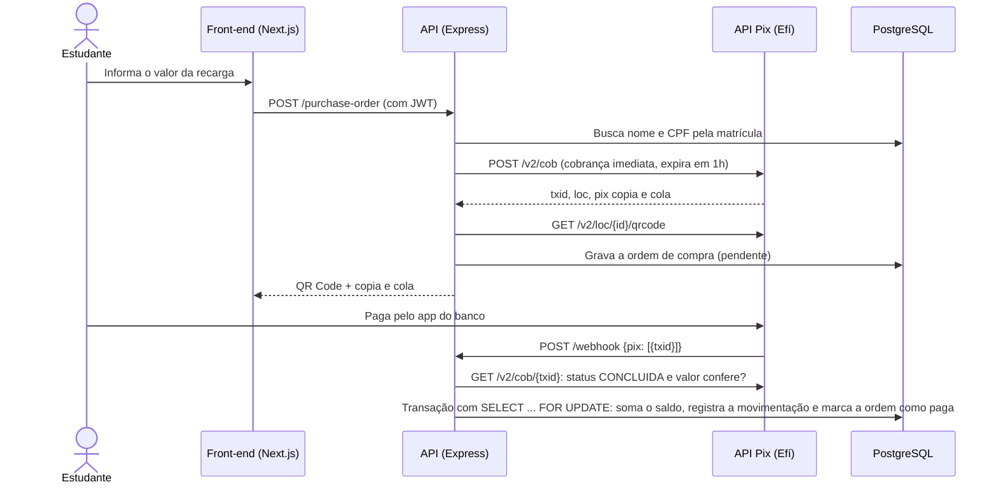

# API de Recarga via Pix para Cartão do RU

Protótipo do meu **Trabalho de Conclusão de Curso**: um sistema para o estudante recarregar o cartão do Restaurante Universitário (RU) da UFMA pagando com **Pix**, sem fila e sem dinheiro em espécie.

O estudante informa o valor, recebe um QR Code (ou o código copia e cola), paga pelo app do banco e o saldo entra no cartão. Cada recarga fica registrada no histórico de movimentações.

> Desenvolvido em 2023–2024. Em 2026 revisei o código e corrigi três falhas de segurança e consistência. Detalhes em [Revisão de 2026](#revisão-de-2026).

## Fluxo da recarga



Três garantias no crédito:

- **Só credita pagamento confirmado na Efí.** O corpo do webhook serve apenas para saber qual `txid` conferir. A API consulta a cobrança na Efí e só credita se o status for `CONCLUIDA` e o valor for o mesmo da ordem. Um webhook forjado não credita nada.
- **Credita uma vez só.** A transação trava a ordem e o cartão (`SELECT ... FOR UPDATE`), e o histórico tem chave primária no `txid`. Notificações repetidas ou simultâneas não duplicam o saldo.
- **Não perde pagamento.** Se uma notificação do webhook não chegar, a consulta da cobrança pelo estudante faz a mesma conferência e credita.

## Funcionalidades

- **Usuários**: cadastro por matrícula, login com **JWT**, senhas com **bcrypt**, papéis (estudante/administrador) e recuperação de senha por e-mail (Nodemailer + OAuth2 do Gmail).
- **Controle de acesso**: o estudante só vê o próprio cartão e as próprias recargas. Crédito e débito manuais, papéis e valor da refeição são só para administradores.
- **Cartão do RU**: consulta de saldo, crédito e débito.
- **Ordens de compra**: criação da cobrança Pix, listagem por matrícula e consulta do QR Code.
- **Integração com a API Pix da Efí**: autenticação OAuth2 com certificado (mTLS), cobrança imediata, QR Code e consulta de status.
- **Valores monetários** validados no formato `"10.00"` e somados com **decimal.js**, para evitar erro de ponto flutuante em dinheiro.
- **Front-end** (`web/`): login, carteira com saldo, solicitação de recarga, tela de pagamento com QR Code e histórico.

## Stack

| Camada | Tecnologias |
|---|---|
| API | Node.js, Express, Knex.js, PostgreSQL, Yup, JWT, bcrypt, decimal.js, Nodemailer |
| Pagamento | API Pix da Efí (antiga Gerencianet), com certificado `.p12` |
| Front-end | Next.js 14 (App Router), React 18, TypeScript, Tailwind CSS, Axios |
| Infra | Docker Compose (PostgreSQL 17 com locale pt_BR) |

## Estrutura

```
├── server.js, routes.js       # entrada da API (porta 3003) e agregação das rotas
├── routes/                    # rotas por recurso, com os middlewares de acesso
├── controllers/               # validação da entrada e orquestração
├── services/                  # confirmação do pagamento (webhook e consulta)
├── models/                    # acesso ao banco com Knex
├── apis/apiPix/               # autenticação e chamadas à API Pix
├── middleware/                # JWT, administrador e dono da matrícula
├── utils/                     # operações monetárias, datas, e-mail
├── database/                  # schema, seed de desenvolvimento e Dockerfile do Postgres
├── docker-compose.yml
└── web/                       # front-end em Next.js
```

## Como rodar

Pré-requisitos: Node.js 18+, Docker e, para gerar cobranças de verdade, uma conta na Efí com a API Pix habilitada (o ambiente de homologação serve para testes).

```bash
# Banco (cria as tabelas e os usuários de exemplo)
docker compose up -d

# API
npm install
cp envExemple.env .env          # banco: localhost:5433, usuário/senha/banco "ru"
mkdir -p certificates/apis/apiPix
# copie o certificado .p12 da Efí para essa pasta e coloque o nome dele em EFI_NAME_CERT
npm run dev                     # http://localhost:3003

# Front-end
cd web
npm install
npm run dev                     # http://localhost:3000
```

Usuários de exemplo (senha `senha123`): `estudante@exemplo.com` (matrícula 2023000001) e `admin@exemplo.com`.

Para receber os webhooks, a URL `/webhook` precisa estar cadastrada na Efí e acessível por HTTPS. A pasta `certificates/` e o `.env` estão no `.gitignore`: certificado e credenciais nunca vão para o repositório.

## Rotas

| Método | Rota | Acesso | O que faz |
|---|---|---|---|
| POST | `/user` | público | Cadastra estudante |
| POST | `/login` | público | Autentica e devolve o JWT |
| POST | `/recovery-password` | público | Envia o e-mail de recuperação de senha |
| PUT | `/recovery-password/:token` | público | Troca a senha |
| GET | `/food-value` | público | Valor da refeição |
| POST | `/webhook` | Efí | Notificação de pagamento (conferida na Efí antes de creditar) |
| POST | `/card/info` | dono ou admin | Cartão e saldo |
| POST | `/purchase-order` | dono ou admin | Cria a cobrança Pix da recarga |
| GET | `/purchase-order/:matriculation` | dono ou admin | Lista as recargas |
| GET | `/purchase-order/:matriculation/:txid` | dono ou admin | Consulta uma cobrança e o QR Code (e confere o pagamento se estiver pendente) |
| GET | `/user/:id` | dono ou admin | Dados do usuário |
| GET | `/user` | admin | Lista os usuários |
| PATCH | `/user/role/:id` | admin | Altera o papel |
| PATCH | `/card/add`, `/card/subtract` | admin | Crédito manual / débito da refeição |
| PUT | `/food-value/:id` | admin | Altera o valor da refeição |

## Revisão de 2026

Revisitei o projeto dois anos depois e corrigi três falhas, cada uma num commit próprio e testada antes e depois:

| Falha | Como estava | Como ficou |
|---|---|---|
| **Pagamento não confirmado** | O crédito vinha de `GET /api-pix/:txid`, sem consultar a Efí: quem tivesse um `txid` creditava sem pagar. O webhook só registrava a notificação no log. | O webhook confere a cobrança na Efí (status e valor) antes de creditar. A rota antiga foi removida. |
| **Rotas sem autenticação** | Os middlewares existiam, mas só uma rota os usava. Qualquer pessoa podia creditar saldo, virar administrador ou ver dados de outro estudante. | Toda rota tem nível de acesso (público, dono da matrícula ou administrador), e o front envia o token. |
| **Crédito duplicado** | Com 50 chamadas simultâneas para a mesma cobrança, a recarga era creditada de 4 a 6 vezes. | `SELECT ... FOR UPDATE` na ordem e no cartão: exatamente um crédito por cobrança. |

Também reescrevi o schema do banco, que estava desatualizado em relação ao código, e adicionei o Postgres em Docker.

**Ainda falta:**
- testes automatizados (as correções foram testadas com uma Efí simulada localmente, mas os testes não estão no repositório);
- a rota `POST /card` chama um método que não existe no model, então o cartão hoje é criado pelo seed;
- o token fica num cookie gravado pelo JavaScript; o ideal é um cookie `httpOnly` definido pelo servidor.

## Autor

Hígor Pinheiro Costa · [LinkedIn](https://www.linkedin.com/in/higor--costa) · [GitHub](https://github.com/higorcos)
