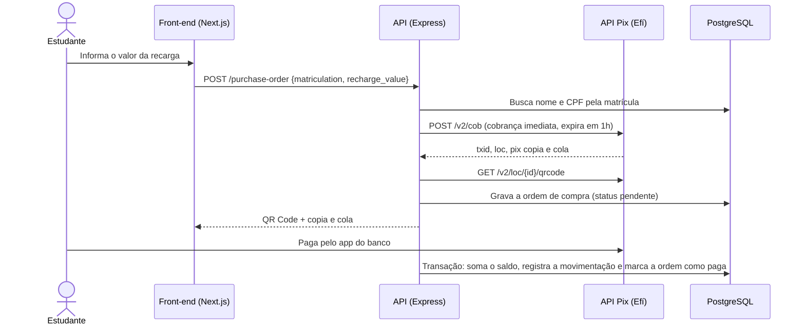

# API de Recarga via Pix para Cartão do RU

Protótipo do meu **Trabalho de Conclusão de Curso**: um sistema para o estudante recarregar o cartão do Restaurante Universitário (RU) da UFMA pagando com **Pix**, sem fila e sem dinheiro em espécie.

O estudante informa o valor, recebe um QR Code (ou o código copia e cola), paga pelo app do banco e o saldo entra no cartão. Cada recarga fica registrada no histórico de movimentações.

> Projeto de 2023–2024, mantido como foi apresentado. A seção [Limitações conhecidas](#limitações-conhecidas) lista o que eu mudaria hoje.

## Fluxo da recarga



O crédito no cartão acontece **dentro de uma transação do banco**: atualizar o saldo, gravar a movimentação e mudar o status da ordem dão certo juntos ou são desfeitos juntos. A ordem só é creditada se ainda estiver pendente, o que evita creditar duas vezes a mesma cobrança.

## Funcionalidades

- **Usuários**: cadastro por matrícula, login com **JWT**, senhas com **bcrypt**, papéis (estudante/administrador) e recuperação de senha por e-mail (Nodemailer + OAuth2 do Gmail).
- **Cartão do RU**: criação, consulta de saldo, crédito e débito.
- **Valor da refeição**: consulta e atualização.
- **Ordens de compra**: criação da cobrança Pix, listagem por matrícula e consulta do QR Code de uma cobrança.
- **Integração com a API Pix da Efí**: autenticação OAuth2 com certificado (mTLS), criação de cobrança imediata e geração do QR Code.
- **Valores monetários** validados no formato `"10.00"` e somados com **decimal.js**, para evitar erro de ponto flutuante em dinheiro.
- **Front-end** (`web/`): login, carteira com saldo, solicitação de recarga, tela de pagamento com QR Code e histórico.

## Stack

| Camada | Tecnologias |
|---|---|
| API | Node.js, Express, Knex.js, PostgreSQL, Yup, JWT, bcrypt, decimal.js, Nodemailer |
| Pagamento | API Pix da Efí (antiga Gerencianet), com certificado `.p12` |
| Front-end | Next.js 14 (App Router), React 18, TypeScript, Tailwind CSS, Axios |

## Estrutura

```
├── server.js, routes.js       # entrada da API (porta 3003) e agregação das rotas
├── routes/                    # rotas por recurso
├── controllers/               # validação da entrada e orquestração
├── models/                    # acesso ao banco com Knex
├── apis/apiPix/               # autenticação e chamadas à API Pix
├── middleware/                # verificação do JWT e do papel de administrador
├── utils/                     # operações monetárias, datas, e-mail
├── database/sql.sql           # criação das tabelas
└── web/                       # front-end em Next.js
```

## Como rodar

Pré-requisitos: Node.js 18+, PostgreSQL e uma conta na Efí com a API Pix habilitada (o ambiente de homologação serve para testes).

```bash
# API
npm install
cp envExemple.env .env          # preencha as variáveis
psql -d <seu_banco> -f database/sql.sql
mkdir -p certificates/apis/apiPix
# copie o certificado .p12 da Efí para essa pasta e coloque o nome dele em EFI_NAME_CERT
npm run dev                     # http://localhost:3003

# Front-end
cd web
npm install
npm run dev                     # http://localhost:3000
```

A pasta `certificates/` e o `.env` estão no `.gitignore`: certificado e credenciais nunca vão para o repositório.

## Rotas principais

| Método | Rota | O que faz |
|---|---|---|
| POST | `/user` | Cadastra usuário |
| POST | `/login` | Autentica e devolve o JWT |
| POST | `/recovery-password` | Envia o e-mail de recuperação de senha |
| PUT | `/recovery-password/:token` | Troca a senha |
| POST | `/card` | Cria o cartão do RU |
| POST | `/card/info` | Consulta o cartão e o saldo |
| GET / PUT | `/food-value` | Consulta / atualiza o valor da refeição |
| POST | `/purchase-order` | Cria a cobrança Pix da recarga |
| GET | `/purchase-order/:matriculation` | Lista as recargas do estudante |
| GET | `/purchase-order/:matriculation/:txid` | Consulta uma cobrança e o QR Code |
| GET | `/api-pix/:txid` | Credita a recarga no cartão |
| POST | `/webhook` | Recebe as notificações de pagamento da Efí |

## Limitações conhecidas

O que eu faria diferente hoje:

- **Confirmação do pagamento.** O webhook só registra a notificação no log, e o crédito é disparado pela rota `GET /api-pix/:txid`, sem consultar na Efí se a cobrança foi paga. O certo é creditar a partir do webhook, conferindo o status da cobrança (`GET /v2/cob/:txid`) antes.
- **Autenticação nas rotas.** Os middlewares de JWT e de administrador existem, mas só a rota `GET /user` usa. Rotas como crédito no cartão, troca de papel e valor da refeição precisam exigir login e, quando for o caso, perfil de administrador.
- **Concorrência.** A transação não trava a linha da ordem (`SELECT ... FOR UPDATE`). Duas chamadas ao mesmo tempo poderiam creditar duas vezes.
- **Testes e Docker.** Não há testes automatizados nem `docker-compose` para subir API e banco juntos.

## Autor

Hígor Pinheiro Costa · [LinkedIn](https://www.linkedin.com/in/higor--costa) · [GitHub](https://github.com/higorcos)
